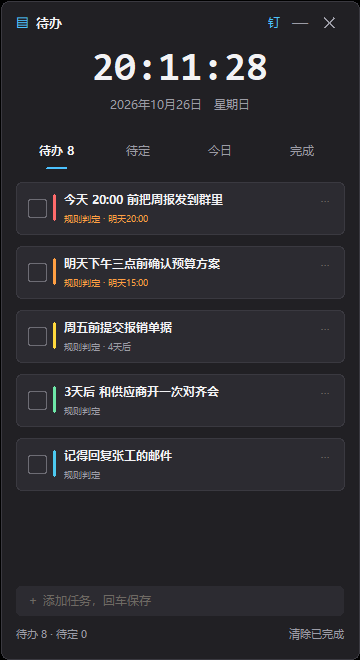

# TodoSeine

[](https://github.com/ycw080619/todoseine/actions/workflows/ci.yml)

**本地优先的聊天记录 → 待办提取器。** 零依赖开箱即用 · 仅适配 Windows 11 · AI / 截图待办 / 桌面看板均为可选增强。

> Local-first chat-to-todo extractor. Zero-dependency core, offline by default. Windows 11 only.



---

## 它解决什么问题

群聊里 80% 是闲聊，真正需要你动手的只有几条：「明天下午三点前把表发给老王」「@你 记得报名」。
TodoSeine 把这些话自动挑出来，汇成一份待办清单，放在桌面看板上。它只回答一个问题：**还需要我做什么？**

它**不**分析社交关系、**不**做词云、**不**联网上传、**不**修改 QQ 任何东西（纯只读）。

---

## 3 步上手（小白路径）

1. **装 Python 3.10+** → 双击 `tools/qq_db_export/console.bat` 打开控制台
2. 点「导入文件」选一份导出的 txt / JSON → 点「打开看板」
3. 或直读 QQ 数据库：进「设置」填一次口令（DPAPI 加密保存）→ 点「立即同步」

> 想要常驻托盘、玻璃质感看板 + 实时监听的版本：`python -m PyInstaller todoseine_qt.spec` → `dist/todoseine_qt.exe`（约 54 MB，需 `pip install -e ".[qt]"`）。
>
> Release 安装包将在验证通过后发布到 [Releases](https://github.com/ycw080619/todoseine/releases) 页面。

---

## 用户分层

| 层级 | 你是谁 | 你用到的能力 |
|---|---|---|
| 纯小白 | 双击就用 | 控制台：导入文件 / 看板 |
| 普通用户 | 想更省事 | 截图待办（Win+Shift+S + 按钮）、Ctrl+Alt+S 全局热键、定时同步、桌面监视 |
| 进阶玩家 | 直读 QQ 库 | 立即同步（QQ 数据库只读直取）、AI 复核/意图/改写、语义去重 |
| 命令行用户 | 脚本化集成 | `c2t` 全套子命令 + `C2T_*` 环境变量 |
| 开发者 | 想贡献代码 | 适配器 / tools 插件范式，pytest 全套测试护航 |

完整的分层设计与上手流程见 [分层方案.md](分层方案.md)；非技术介绍见 [项目说明.md](项目说明.md)。

---

## 特性

- **零依赖核心**：纯 Python 标准库，核心包永不引入第三方依赖
- **三条采集链路**：QQ 数据库只读直取 / 导出文件导入 / 屏幕截图 OCR（快捷键 `Ctrl+Shift+S` 建待办）；Qt 版还能常驻托盘、定时截屏 OCR 做实时增量
- **桌面看板（Qt 版）**：PySide6 无边框窗口 + DWM 圆角/系统材质，待办/回收站/统计/设置/关于五页；迷你胶囊、位置记忆、贴边吸附、拖边改宽、锁定、静音、撤销、定位下载文件、判定理由一应俱全，托盘常驻 + 全局热键 + 到期气泡提醒
- **可解释规则**：每条待办附带判定理由与置信度；≥4 分判待办、3 分待确认；`c2t explain <id>` 可打印完整判定链路（规则分解 + 校准命中 + 原消息）
- **本地校准闭环**：你每次「标为非待办 / 标记完成」，都会写入本地反馈表；同一来源攒够 3 条样本后自动调权，误判越点越少。校准档案可导出/导入，换机不丢
- **可选 AI 复核**：本地 Ollama（免费）或云端 OpenAI 兼容 API（DeepSeek / 豆包 / 通义千问 / OpenAI GPT·Codex / Claude·OpenRouter 预设一键填）；不可用时静默退回规则结果，不丢数据
- **双引擎截图识别**：默认 Windows 自带 OCR（离线零安装），配置视觉模型后自动升级
- **桌面看板**：玻璃质感悬浮窗，待办/待定/今日/完成四标签、底部回车快速添加、滚轮翻页、Ctrl+滚轮调透明度、可收起成小时钟胶囊、可置顶、支持撤销（Ctrl+Z）与右键菜单
- **幂等入库**：重复导入不产生重复数据
- **开放格式**：内部模型与 ChatLab Format 对齐，可互导（`export-chatlab` 反向导出）
- **可被别的工具调用**：`c2t serve` 起一个只听本机的 HTTP API，脚本 / 浏览器页面 / 自动化工具都能读写待办
- **插件注册协议**：`plugin.manifest.json` 声明插件能力与权限级别（file / db / uia），`c2t plugins` 一键列出已装插件
- **隐私守门**：口令 DPAPI 加密存放；QQ 库纯只读；默认零网络请求（除 127.0.0.1 本机 Ollama）
- **全链路脱敏**：手机号 / 身份证 / 银行卡 / 邮箱默认打码，日志、看板、归档、导出、AI 请求统一走同一套规则；白名单群只豁免「归档与看板展示」，AI 请求仍强制脱敏；确需发明文到云端 AI 时，得单独打开「AI 明文」开关（二次确认，可再按群号收窄）
- **数据可带走**：消息按「群名/年/月/日.md」归档 + `manifest.json` 去重；Obsidian 双向同步（勾选回写、MD5 增量、冲突留 `.conflict.bak`）
- **自动备份与清空**：每天一次 DPAPI 加密备份（保留 7 份）、回收站 7 天自动清理、一键清空程序数据（库 / 归档 / 备份 / 日志，保留插件与选择器）
- **桌面美化联动（可选）**：输出脱敏 `todos.json` / `todos.ics`，1~2 秒防抖；小组件勾选、编辑、删除通过 `127.0.0.1` 本地接口（随机端口 + token + Host/Origin 校验）回写数据库
- **Hermes 运维（可选）**：本机 token 鉴权（DPAPI 加密存储、设置页复制/轮换）、状态查询、巡检自动重启采集、每日汇总 Markdown；对外协议见 [docs/hermes-skill.md](docs/hermes-skill.md)
- **插件隔离**：插件跑在独立子进程，权限按 manifest 白名单授予；7 天内崩溃 2 次自动进安全模式，一键回滚到安装前快照


---

## 命令行速览

```bash
pip install -e .            # 或免安装：PYTHONPATH=src python -m todoseine ...

c2t import chat.txt --db qq.db      # 导入导出文件（txt / ChatLab JSON）
c2t db-key --save                   # 保存 QQ 库口令（DPAPI 加密）
c2t db                              # 数据库通道自检：定位 / 引擎 / 试读
c2t db-import --days 7 --db qq.db   # 只读拉取最近 7 天消息
c2t db-backfill                     # 给历史消息补来源群（不跑抽取、不调用 AI）
c2t purge-chat --list               # 看库里各来源群及条数
c2t purge-chat --chat 123456 --dry-run   # 按群清理前先预览
c2t todos / done / search / show    # 查看 / 完成 / 检索 / 上下文
c2t explain 12                      # 这条待办为什么被判成待办
c2t export --format md --out out    # 导出 md / csv / json
c2t export-chatlab out.json         # 反向导出为 ChatLab Format（.json / .jsonl）
c2t export-calibration my.json      # 导出校准档案（换机迁移）
c2t plugins                         # 列出已装插件（读 plugin.manifest.json）
c2t plugin-status                   # 插件运行状态：启用列表 / 崩溃次数 / 安全模式
c2t plugin-enable snap_todo         # 启用插件（自动打快照，可回滚）
c2t plugin-rollback                 # 回滚到安装前快照并退出安全模式
c2t migrate --dry-run               # 看库版本；去掉 --dry-run 执行（迁移前自动备份）
c2t backup                          # 手动备份一次（默认 DPAPI 加密）
c2t wipe --yes                      # 清空程序数据（库 / 归档 / 备份 / 日志）
c2t obsidian-sync                   # 与 Obsidian 库双向同步待办
c2t desktop-export --serve          # 输出脱敏 JSON/ICS 并起本机回写接口
c2t desktop-token --rotate          # 轮换桌面联动 token
c2t hermes-token                    # 查看 Hermes token（--rotate 轮换）
c2t hermes-summary --out 今日.md     # 生成当日汇总
c2t sbom                            # 生成 SBOM 与第三方许可证清单
c2t serve --port 8765               # 起本地 HTTP API（仅 127.0.0.1）
c2t dash --db qq.db                 # 悬浮待办看板
c2t doctor                          # 环境自检
```

截图待办（独立插件，tools/snap_todo/）：

```bash
snap.py                 # 处理一次剪贴板截图
snap.py --hotkey        # 常驻：Ctrl+Alt+S 唤出
snap.py --watch         # 监视剪贴板，截一张处理一张
```

---

## 可选增强模块（一键开关，按需启用）

| 模块 | 功能说明 | 默认 |
|---|---|---|
| WebDAV / 本地 HTTP 看板 | 浏览器打开看板，只监听 `127.0.0.1` | 关 |
| AI 复核 | 本地 Ollama 或云端 OpenAI 兼容 API，多档案 + 预设模板 + 连接测试 + 每日 token 额度 | 关 |
| 数据看板 | Qt 悬浮看板：不抢焦点、透明度、贴边收起、待办编辑 | 随 Qt 版启用 |
| 桌面美化联动 | 脱敏 `todos.json` / `todos.ics` + 本机回写接口（随机端口 + token） | 关 |
| Obsidian 双向同步 | 待办镜像进库、勾选回写、冲突留档 | 关（需填库路径） |
| Hermes 运维 | 本机 token 鉴权 / 巡检自动重启 / 每日汇总 | 开（仅本机） |
| 插件平台 | 子进程隔离、权限白名单、安全模式、一键回滚 | 开（空插件列表） |
| Docker 部署方案 | 仅 Ollama / AnythingLLM 等纯后端服务容器化，主程序通过本地 HTTP 对接 | 进阶可选，见 [deploy/](deploy/) |

> 首次运行未签名版本时 Windows SmartScreen 会提示「Windows 已保护你的电脑」，
> 点「更多信息 → 仍要运行」即可。若被杀软误报，参见 [SECURITY.md](SECURITY.md)。

---

## 本地 HTTP API

`c2t serve` 起一个纯标准库的 HTTP 服务，**只监听 `127.0.0.1`**，给脚本或其他工具读写待办：

```bash
c2t serve --port 8765
curl http://127.0.0.1:8765/health
curl "http://127.0.0.1:8765/todos?status=pending&limit=10"
curl "http://127.0.0.1:8765/search?q=周报"
curl -X POST -H "Content-Type: application/json" http://127.0.0.1:8765/todos/1/done
```

| 方法 | 端点 | 说明 |
|------|------|------|
| GET | `/health` | 健康检查 |
| GET | `/todos?status=&limit=` | 待办列表（`pending` / `done` / `noise`，留空=全部） |
| GET | `/stats` | 统计摘要 + 近 7 天摘要 |
| GET | `/search?q=&limit=` | 全文搜索消息 |
| POST | `/todos/{id}/done` | 标记完成；可选请求体 `{"status": "pending"}` 改回待办 |

安全边界：非本机连接一律 403；请求体上限 64 KB 且只收 JSON；CORS 只回本机来源（不回 `*`），避免任意网页读走本地聊天数据。

---

## 数据流

```
QQ 数据库（只读）     导出文件          剪贴板截图
   db-import          import       OCR / 视觉模型 + 人工确认
      └────────┬─────────┴─────────────┘
               ▼
     去重 → 规则打分 → 语义清洗 → AI 复核（可选）
               ▼
        SQLite 单库 qq.db
               ▼
   悬浮看板 / 控制台统计 / 导出 md·csv·json
```

---

## 如何导出聊天记录

| 平台 | 获取方式 | 适配器 |
|---|---|---|
| QQ | 「聊天记录」→ 导出 txt；或用数据库只读通道免导出 | `qq_txt` / `db-import` |
| 微信 | 第三方工具导出的 txt（三种行头自动识别） | `wechat_txt` |
| 通用 | ChatLab Format JSON / JSONL | `chatlab_json` |

导出建议：**脱敏后再测试**；提交 issue 请勿附真实聊天内容。

---

## 路线图

- [x] v0.1 QQ txt 导入、去重、规则抽取、SQLite、Markdown
- [x] v0.3 微信 txt 适配器
- [x] v0.4 QQ NT 数据库只读通道（sqlcipher3 + DPAPI 密钥保管）、语义清洗（bge-m3）、LLM 复核/意图/改写（Ollama）
- [x] 2026-10 控制台 GUI、悬浮看板、定时同步、截图待办插件（Windows OCR + 视觉模型双引擎）、全局热键
- [x] 第三方插件注册协议（manifest / 权限声明）+ `c2t plugins`
- [x] 本地 HTTP API（`c2t serve`，仅 127.0.0.1）
- [x] PySide6 桌面看板（托盘常驻 / 实时截屏 OCR 监听 / 全局热键 / 回收站·统计·关于 / 迷你胶囊）
- [ ] ChatLab Format 深度对齐（已支持双向互导，持续跟进上游字段）
- [ ] MCP 接口
- [ ] 多操作系统适配（当前仅 Win11）

---

## 安全与合规

- 只处理**你本人有权访问**的聊天记录；数据库通道纯只读，不注入、不抓包、不模拟登录
- 不提供、不接受任何注入/抓包/模拟登录相关的代码或 PR；口令提取工具不随本项目分发。可使用社区工具提取（QQ 保持登录运行时从内存扫描，一次性）：[QQBackup/qq-win-db-key](https://github.com/QQBackup/qq-win-db-key)、[NapCatQQ](https://github.com/NapNeko/NapCatQQ)、[QQ-MCP-Server](https://github.com/print-yuhuan/QQ-MCP-Server)
- 实时监听只做两件事：截自己屏幕 + 系统 OCR 认字。不 hook、不注入、不读 QQ 的存储文件，读到的内容不会超过你屏幕上看到的内容；不做群发
- 涉及他人隐私请自行取得知情同意；分析结果不得作为法律证据或决策依据

详见 [SECURITY.md](SECURITY.md)。

## 贡献

见 [CONTRIBUTING.md](CONTRIBUTING.md)。最需要**新平台适配器**与 **tools/ 插件**。注意：核心包零第三方依赖是硬约束，可选能力请放插件层。

## 致谢

- [DeskBox](https://github.com/Tianyu199509/DeskBox) — 桌面小组件与看板交互的设计参考
- qq-live-digest — 事件驱动与消息抽取的设计思路参考
- [QQBackup/qq-win-db-key](https://github.com/QQBackup/qq-win-db-key)、[NapCatQQ](https://github.com/NapNeko/NapCatQQ)、[QQ-MCP-Server](https://github.com/print-yuhuan/QQ-MCP-Server) — QQ NT 数据库口令提取工具

## 许可证

MIT
